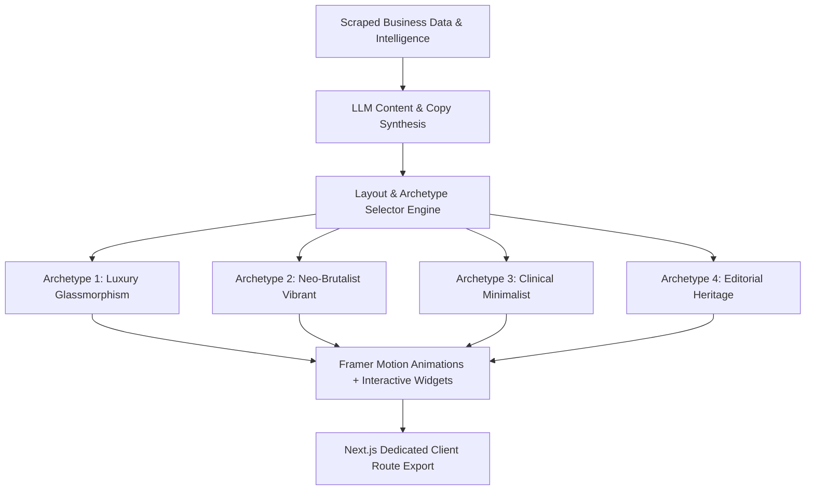

# 🛑 Deep Analysis: Client Template Design, Aesthetic & UX Deficiencies (`client-template-issue.md`)

This document provides an exhaustive, root-cause critique of why the current client website template engine falls short of a true high-end, human-crafted agency design, and details the exact architectural, visual, and UX overhauls required to fix it.

---

## 1. 🚨 Core Root Causes: Why Sites Still Feel AI-Generated & Generic

### Issue 1.1: Monolithic Single-File Component Renderer (`DynamicClientSite.tsx`)
* **The Problem**: Instead of dedicated, bespoke React components for each design archetype (e.g. `LuxuryGlassmorphismHero.tsx`, `NeoBrutalistHero.tsx`, `EditorialMinimalistHero.tsx`), the entire website is rendered by a single monolithic file (`DynamicClientSite.tsx`).
* **Why it looks bad**: Switches inside one file lead to reused DOM structures, shared Tailwind utility classes, identical padding (`py-20 px-4`), identical flex containers, and identical button styles across different themes.
* **The Solution**: Split into separate, fully self-contained component directories per Archetype, each with custom layout HTML structures, distinct micro-animations, and theme-specific UI components.

### Issue 1.2: Static Content & Missing High-Value Interactive UI Widgets
* **The Problem**: The Hero, Services, and CTA sections consist of static text boxes and images. They lack real interactive widgets that modern high-converting websites use.
* **Missing Interactive Widgets**:
  1. **Before/After Smile & Treatment Comparison Slider**: Drag-to-compare interactive image slider for cosmetic dentistry, MedSpas, and roofing/renovation.
  2. **Interactive Instant Cost & Treatment Calculator**: Slider widget estimating treatment cost, financing monthly installments, and insurance coverage.
  3. **Live Interactive Date & Slot Booking Widget**: Real-time calendar grid inside the hero allowing patients to tap a time slot (e.g. "Today 3:30 PM").
  4. **Doctor & Specialist Bio Cards**: Interactive tabbed cards showing the practitioner's credentials, video introduction, and patient satisfaction score.
  5. **Interactive Service Comparison Matrix**: Toggleable side-by-side breakdown comparing standard care vs. private boutique care.

### Issue 1.3: Flat Lighting & Generic Color Tokens
* **The Problem**: Background colors rely on static hex codes (`#07101f`, `#ffffff`, `#09090b`) without dynamic color science (HSL custom property maps, noise overlays, multi-layered mesh gradients, or glass reflection hairlines).
* **Why it looks bad**: Without subtle ambient light blurs, mesh textures, or gradient borders (`border-image` or layered `box-shadow`), dark modes look flat like a dark code editor, and light modes look like plain Bootstrap templates.
* **The Solution**: Implement dynamic CSS HSL variables (`--hue`, `--saturation`, `--lightness`) with ambient noise backgrounds, mesh gradient canvases, and organic glow spots.

### Issue 1.4: Repetitive Copywriting & Cliché Formats
* **The Problem**: Prompts and fallbacks default to corporate generic slogans:
  * *"Exceptional Dental Care in Manchester"*
  * *"Specialized Treatments & Procedures"*
  * *"Your Care Journey"*
* **Why it looks bad**: Real high-end business websites write unique, story-driven copy with specific local landmarks, explicit pricing ranges, doctor quotes, and patient-first headlines (e.g. *"Wake Up to a Perfect Smile: Pain-Free Cosmetic Dentistry in St. Ann's Square"*).
* **The Solution**: Overhaul LLM prompt engineering to mandate niche-specific storytelling, patient anxiety reframing, and explicit local context.

### Issue 1.5: Lack of Framer Motion Micro-Animations & Page Transitions
* **The Problem**: Elements pop onto the screen instantly or rely on primitive Tailwind CSS transitions.
* **Why it looks bad**: Luxury web design derives its premium feel from subtle scroll-triggered entrance transitions, smooth stagger effects on card lists, parallax scroll shifts, and spring physics on buttons.
* **The Solution**: Integrate `framer-motion` for fluid scroll animations (`animate={{ opacity: 1, y: 0 }}`, staggered child reveals, and magnetic hover buttons).

---

## 2. 📐 Comprehensive Section-by-Section Issue Breakdown

| Section | Current Deficiencies | Required High-End Agency Redesign |
| :--- | :--- | :--- |
| **Header / Nav** | Generic sticky bar with static text buttons. Missing contact drawer, quick call badge glow, or sticky scroll shrink effect. | Dynamic shrinking header on scroll, glowing phone tap-to-call badge, live availability indicator (`🟢 3 Slots Today`), slide-over mobile drawer with booking form. |
| **Hero Section** | Standard text left / image right layout. Lacks dynamic visual widgets or multi-layer depth. | 5 distinct Hero archetypes (Bento Grid, Interactive Split Slider, Full Video Banner, Embedded Slot Booking Form, Magazine Editorial). |
| **Trust Ribbon** | Simple 4-column statistic boxes with border lines. | Animated counter numbers (`CountUp`), partner logos (Invisalign, BDA, Straumann), interactive trust popover cards. |
| **Services / Features** | 3-column card grid with basic checkmarks. | Bento grid layout with focal feature card, tabbed category filter with fluid sliding underline indicator, expandable specialty accordions. |
| **Interactive Calculator** | **Missing entirely.** | Interactive 3-step cost & financing calculator with monthly payment estimator. |
| **Before / After Gallery** | **Missing entirely.** | Interactive touch-swipe before/after image slider with treatment details and patient timeline. |
| **Reviews & Social Proof** | 3 static text cards with avatar initials. | Masonry review grid with Google Star rating filter, video testimonial popups, and verified patient badges. |
| **FAQ Section** | Basic accordion with plus/minus text toggles. | Tabbed FAQ categories (Pricing, Pain Control, Appointments) with inline search bar and quick chat launcher. |
| **CTA Finale** | Centered box container with single button. | Multi-tier CTA (Phone Line, Booking Calendar, Emergency Callback Form) with ambient glow canvas. |

---

## 3. 🎯 Proposed Architecture Plan for 100% Unique Human-Grade Client Sites

### Action Items for Complete Redesign:
1. **Decouple Component Architecture**: Create modular component folders for each Archetype in `client-template/components/archetypes/`.
2. **Integrate Framer Motion & Interactive Widgets**: Add Before/After Slider, Cost Calculator, and Date Picker.
3. **Refine Copy Generation Prompt**: Inject localized narrative story prompts into `site_generator.py`.
4. **Implement HSL Dynamic Palette Engine**: Ensure rich color harmonies with dynamic contrast ratios.
