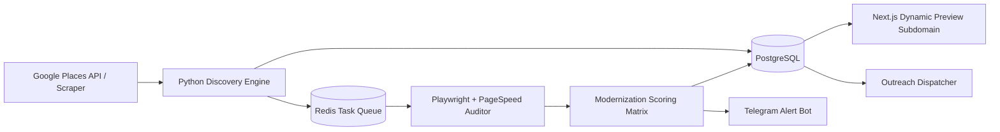

# 01. Architecture Overview

> **System:** Opportunity Finder & Modernization System  
> **Document:** High-level System Topology & Data Flow  
> **Author:** Vipin Pal

---

## 1. System Overview

The Opportunity Finder system is designed as an end-to-end, data-driven diagnostic engine for discovering high-trust, high-value small businesses across target countries (US, UK, AU, DE, FR), auditing their digital presence automatically, scoring their modernization need (0–100), and driving high-converting outbound sales outreach.

---

## 2. Component Diagram

---

## 3. Core Modules & Data Responsibilities

1. **Discovery Module (`src/discovery`):** Interrogates Google Places API by query matrix `[Category] + [City] + [Country]`. Filters out low-rated businesses (< 4.2 stars).
2. **Crawler & Auditor Module (`src/crawler`):** Runs headless browser audits (Playwright), calls Google PageSpeed API, and parses DOM elements for SEO metadata & schema markup.
3. **Scoring Engine (`src/scorer`):** Weighs technical failures to generate a `0 - 100` Modernization Need Score.
4. **Storage & Queue (`src/storage`):** Asynchronous PostgreSQL (via SQLAlchemy + asyncpg) for persistent records and Redis + Celery for worker task management.
5. **Preview Generator:** Auto-populates Next.js client templates hosted on preview subdomains (`preview.yourdomain.com/slug`).
6. **Notification System (`src/notifications`):** Real-time Telegram push notifications dispatched to Vipin's phone when Tier-1 leads (Score > 80) are found.
