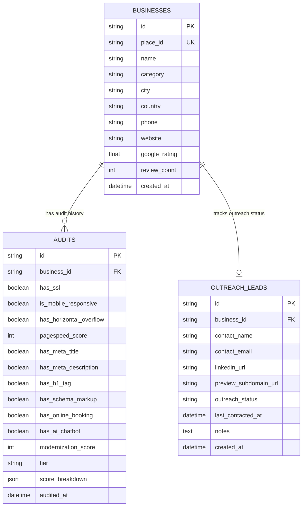

# PostgreSQL Database Schema & Migration Architecture

> **System Layer:** Storage & Relational Database  
> **RDBMS Engine:** PostgreSQL 15+  
> **ORM & Driver:** SQLAlchemy (AsyncIO) + asyncpg  
> **Migration Tool:** Alembic  

---

## 📐 Entity-Relationship Diagram (ERD)

---

## 🗄️ Tables Breakdown

### 1. `businesses`
Stores raw Google Places business directory information.
- `place_id` (Unique Index): Prevents duplicate scraping of the same local business.

### 2. `audits`
Stores detailed mobile UX, PageSpeed, SEO, schema, and modernization scoring results.
- `business_id` (Foreign Key -> `businesses.id`, `ON DELETE CASCADE`).

### 3. `outreach_leads`
Tracks outbound sales progress, contact information, generated website preview links, and notes.
- `outreach_status` Options: `NEW`, `LINKEDIN_SENT`, `EMAIL_SENT`, `WA_SENT`, `RESPONDED`, `CLOSED`.
