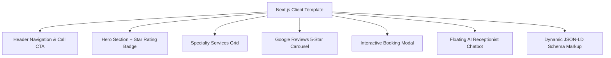

# Next.js Client Web Template & Preview Generator Architecture

> **System Layer:** Frontend & Client Website Modernization Stack  
> **Framework:** Next.js 14 (App Router) + TypeScript + Tailwind CSS / Vanilla CSS  
> **Aesthetics:** Glassmorphism UI, Dark Mode, Google Fonts (Plus Jakarta Sans)  
> **Target Mobile Score:** 95+ Google PageSpeed Insights  

---

## 🎨 UI/UX Component Architecture

---

## 🚀 Key Features

1. **Sub-second Loading & Zero CLS**: Optimized Next.js `Image` components and responsive viewports.
2. **Dynamic JSON-LD LocalBusiness Schema**: Automatically injected into the HTML `<head>` for instant Technical SEO rankings.
3. **Automated Preview Generator**:
   - Python script `scripts/generate_client_preview.py` reads high-priority Tier 1 leads from PostgreSQL DB and generates custom preview URLs at `/preview/[business-slug]`.
4. **AI Receptionist Lead Capture**:
   - 24/7 floating chatbot widget that answers FAQs and dispatches customer leads directly to the business owner via Telegram.
