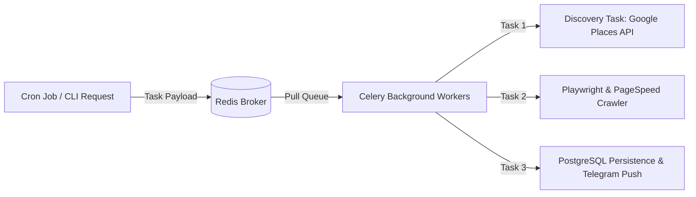

# Async Task Queue & Distributed Worker Architecture

> **System Layer:** Distributed Task Processing  
> **Broker & Backend:** Redis 7+ (`redis://localhost:6379/0`)  
> **Task Framework:** Celery 5.x  

---

## ⚡ Task Flow Architecture



---

## 🛠️ Celery Task Definitions

1. `src.tasks.discovery_tasks.run_discovery_task`:
   - Fetches up to `max_results` qualified leads for a target `category` and `city`.
   - Rate limit: `10/m`.

2. `src.tasks.crawler_tasks.run_site_audit_task`:
   - Runs Playwright mobile rendering + PageSpeed API + BeautifulSoup SEO parser.
   - Rate limit: `15/m` (protects target websites from aggressive crawling).

3. `src.tasks.pipeline_tasks.process_lead_batch_task`:
   - Evaluates score, saves `Business`, `Audit`, and `OutreachLead` records into PostgreSQL, and sends Telegram alert if Tier 1 Priority.

---

## 💻 Launching Workers locally:

```bash
./scripts/run_worker.sh
```
