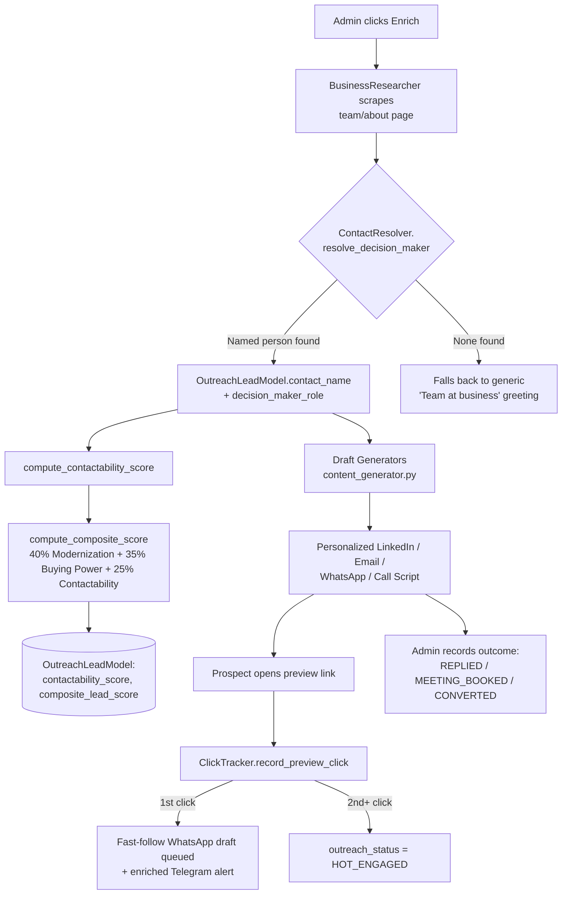

# 06. Lead Quality Scoring & Contact Resolution

> **System:** Rebuildly
> **Document:** Decision-Maker Resolution, Composite Lead Quality Score, Engagement Fast-Follow & Outcome Tracking
> **Core Modules:** `src/outreach/contact_resolver.py`, `src/outreach/click_tracker.py`, `src/storage/models.py` (`OutreachLeadModel`)

---

## 1. The Problem This Solves

The Modernization Need Score (`docs/04_scoring_matrix.md`) measures how broken a business's website is — but a technically perfect Tier-1 lead is worthless if outreach can't actually reach a real decision-maker, or can't afford the project. Before this layer existed:

- `BusinessResearcher` (`src/scraper/business_researcher.py`) already scraped each prospect's real team/about page and extracted verified names + job titles for the generated preview site — but that data never flowed into outreach. Every cold email opened with **"Hi Team at {business name}"** instead of an owner's actual name.
- There was no signal distinguishing a lead with 30 reviews from one with 500 — both passed the same discovery floor and were treated identically.
- A prospect re-opening their preview link after being contacted (the strongest buying-intent signal in the funnel) only triggered a Telegram ping — no automated next action.
- Nothing distinguished an *inbound* response (they replied, they booked a meeting) from the *outbound* actions the system logs automatically (email sent, LinkedIn note copied).

This layer closes all four gaps using data the system already collects, plus a small amount of new state.

---

## 2. 🔁 End-to-End Flow



---

## 3. 🎯 Decision-Maker Resolution

**Module:** `src/outreach/contact_resolver.py`

`ContactResolver.resolve_decision_maker(team)` ranks the (already anti-hallucination-checked) team list returned by `BusinessResearcher._build_team()` by role authority, and picks the single best real contact.

### Role priority (highest authority first)

```
owner → founder → co-founder → managing partner → managing director →
practice manager → principal → director → partner → ceo → head →
manager → senior → (any other named person)
```

Matching is a case-insensitive substring check against each team member's scraped job title. A named person with an unranked title is still preferred over no contact at all — only an empty team list returns `None`, in which case the caller keeps the existing generic "Team at {business}" fallback. **A name is never invented** — this only re-uses data `BusinessResearcher` already verified against the real page content.

### Wiring

| Call site | What it does |
| :--- | :--- |
| `enrich_lead` (`src/api/admin.py`) | After scraping, resolves the decision-maker and persists `contact_name` + `decision_maker_role` onto `OutreachLeadModel` — **only if not already set**, so a manual admin edit is never clobbered by a re-enrich. |
| `get_or_create_drafts`, `generate_ai_sales_copy` (`src/api/crm.py`) | Read the persisted `contact_name` and pass it into `content_generator.generate_all_drafts(...)` / `generate_all_drafts_with_llm(...)` so every draft opens with the real name. |
| Outreach Studio (`OutreachStudioModal.tsx`) | Displays the resolved name + role, and lets the admin correct or add one manually via a "Decision-Maker Name" field — saved through `POST /admin/crm/leads/{id}/drafts`. |

---

## 4. 📊 Composite Lead Quality Score

Three independent sub-scores (each 0–100) combine into one number that answers "is this actually worth pursuing?" — not just "is their website bad?"

| Sub-score | Weight | Computed from | Where |
| :--- | :---: | :--- | :--- |
| **Modernization Need** | 40% | Technical audit penalties (SSL, mobile UX, speed, SEO, schema, booking, chat, review widget, legacy stack) | `src/scorer/scoring_matrix.py` → `AuditModel.modernization_score` |
| **Buying Power** | 35% | Review volume + rating (a proxy for transaction volume/revenue — no extra API calls) | `ModernizationScoringEngine.calculate_buying_power_score` → `AuditModel.buying_power_score` |
| **Contactability** | 25% | Whether a real name/email/LinkedIn was actually found | `ContactResolver.compute_contactability_score` → `OutreachLeadModel.contactability_score` |

### Buying Power buckets

| Review count | Base score | Rating < 4.5 |
| :--- | :---: | :---: |
| 300+ | 100 | −15 |
| 100–299 | 75 | −15 |
| 50–99 | 50 | −15 |
| < 50 | 25 | −15 |

### Contactability formula

```
score = 50 if a real contact_name is set (not the generic "Team at ..." fallback)
      + 35 if contact_email passes syntax validation (EmailVerifier.is_valid_syntax)
      + 15 if a linkedin_url is on file
```

The email check deliberately re-validates syntax rather than trusting truthiness — some flows default `contact_email` to the business's own website URL as a placeholder when nothing better is known, and that must not count as a real contact channel.

### Composite formula

```python
composite = modernization_score * 0.40 + buying_power_score * 0.35 + contactability_score * 0.25
```

**Recomputed automatically** whenever contact info changes — `enrich_lead`, `get_or_create_drafts`, `generate_ai_sales_copy`, `save_edited_drafts`, and `send_email_manually` all call `_recompute_lead_scores` / the equivalent inline logic after touching `contact_name`, `contact_email`, or `linkedin_url`. This means the score is always live, not a one-time snapshot.

**Surfaced in:**
- CRM lead table — dedicated "Lead Quality" column with a Contactability sub-line (`client-template/app/crm/page.tsx`)
- `GET /admin/leads?sort_by=lead_quality` — sort the whole pipeline by composite score instead of raw technical need
- Outreach Studio header — shown next to the resolved decision-maker

---

## 5. 📲 Click-Signal Fast-Follow

**Module:** `src/outreach/click_tracker.py`

A prospect re-opening their personalized preview link is the strongest buying-intent signal in the funnel — stronger than the Modernization Score itself, because it's *them* acting, not an algorithm scoring their website. Previously this only triggered a Telegram ping; now it triggers a real next step.

| Event | Action |
| :--- | :--- |
| **1st click** | `preview_clicked=True`, `click_count` incremented, `outreach_status` → `VIEWED` (if it was `NEW`/`EMAIL_SENT`). An `OutreachLogModel` entry (`channel=WHATSAPP`, `action=FASTFOLLOW_QUEUED`) is written containing the already-generated WhatsApp draft text, ready to copy-send within minutes. |
| **2nd+ click** (and status not `CONVERTED`/`OPTED_OUT`) | `outreach_status` → `HOT_ENGAGED`. This is a distinct, higher-urgency state from plain `VIEWED` — it means they came back *after* being contacted. |

The Telegram alert (`TelegramAlertService.send_click_alert` in `src/notifications/telegram_bot.py`) is enriched to match: it embeds the ready-to-send WhatsApp text directly in the message, and — when a phone number is on file — adds a one-tap `wa.me` deep link button so the fast-follow can go out in seconds, not whenever the admin next opens the CRM.

---

## 6. 🏷️ Outreach Status Lifecycle

```
NEW → (contacted) → LINKEDIN_SENT / EMAIL_SENT / WA_SENT / CALLED
                          │
                          ▼ (prospect clicks preview link)
                       VIEWED ──(2nd+ click)──▶ HOT_ENGAGED
                          │
                          ▼ (admin records inbound response)
                REPLIED / MEETING_BOOKED
                          │
                          ▼
                     CONVERTED  (or OPTED_OUT at any point)
```

`REPLIED` and `MEETING_BOOKED` are the key addition: they are **inbound** signals, set explicitly by the admin (via "Mark as Replied" / "Mark as Meeting Booked" buttons in the Outreach Studio, or `POST /admin/crm/leads/{id}/status`), and are logically distinct from the `*_SENT` statuses the system sets automatically for its own outbound actions. Every status change is logged to `OutreachLogModel` as `STATUS_CHANGED_TO_{status}`, so the full inbound/outbound history per lead is queryable, not just the current state.

---

## 7. 🗄️ Database Schema

Migration: `alembic/versions/002_lead_quality_scoring.py`

| Table | New Column | Purpose |
| :--- | :--- | :--- |
| `audits` | `buying_power_score` (Integer, default 0) | Discovery/scoring-time buying-power proxy |
| `outreach_leads` | `decision_maker_role` (String, nullable) | Job title paired with `contact_name` |
| `outreach_leads` | `contactability_score` (Integer, default 0) | 0–100, see formula above |
| `outreach_leads` | `composite_lead_score` (Integer, nullable) | The blended 0–100 score |

---

## 8. 🌐 API Surface

| Endpoint | Change |
| :--- | :--- |
| `POST /api/v1/admin/leads/{id}/enrich` | Now resolves + persists the decision-maker contact and recomputes scores after scraping. |
| `GET /admin/crm/leads/{id}/drafts` | Returns `contact_name`, `decision_maker_role`, `contactability_score`, `composite_lead_score` alongside the drafts. |
| `POST /admin/crm/leads/{id}/generate-ai-copy` | Passes the resolved `contact_name` into the LLM sales agent. |
| `POST /admin/crm/leads/{id}/drafts` | Accepts `contact_name` / `linkedin_url` edits (previously email/phone only) and recomputes scores when they change. |
| `POST /admin/crm/leads/{id}/status` | Accepts `HOT_ENGAGED`, `REPLIED`, `MEETING_BOOKED` in addition to the original status set. |
| `GET /api/v1/admin/leads?sort_by=lead_quality` | New sort option — orders by `composite_lead_score` instead of raw modernization score. |
