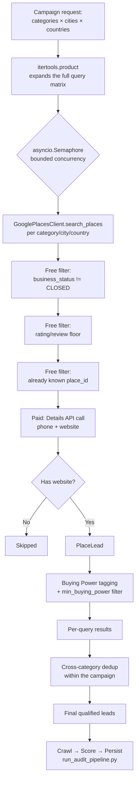

# 08. Lead Discovery Engine

> **System:** Rebuildly
> **Document:** Multi-Dimensional Discovery Campaigns, Resilience, Deduplication & API Budget Control
> **Core Module:** `src/discovery/discovery_engine.py` (`DiscoveryEngine`)

---

## 1. The Problem This Solves

Before this rewrite, discovery had five structural limitations, despite the system's own docs (`Idea-plan.md`) naming five target countries:

1. **Hardcoded to one country.** `run_pipeline` in `scripts/run_audit_pipeline.py` passed `country="UK"` unconditionally — a real bug, not a design choice. Nothing could discover leads outside the UK no matter what the caller requested.
2. **One category per job.** A "campaign" meant one category × a list of cities, run sequentially. Covering multiple categories required multiple manual admin clicks.
3. **No resilience.** A single failed HTTP request or a Google `OVER_QUERY_LIMIT` response silently broke the whole discovery loop.
4. **No cost awareness.** `Idea-plan.md` Section 9 explicitly names Places API cost as a risk — but nothing tracked spend, capped it, or avoided re-paying for businesses already in the database.
5. **No quality pre-filtering.** Every result passing the bare 4.2★/30-review floor proceeded to the expensive crawl/audit stage, even if it was obviously a low-value business.

`DiscoveryEngine` replaces the single-query call with a real campaign orchestrator addressing all five.

---

## 2. 🌍 Campaign Flow



Each stage is deliberately ordered cheapest-first: the two free filters (closed-business status and rating/review floor come straight back in the Text Search response) run *before* the paid Details call, and the known-business dedup check runs before that too — so a re-run of a city you've already discovered costs almost nothing.

---

## 3. 🧮 The Campaign Matrix

**Entry point:** `DiscoveryEngine.run_campaign(categories, cities, countries, max_per_city, job_id, skip_known, min_buying_power)`

```python
combos = list(product(categories, cities, countries))
```

A request for `categories=["Dentist", "Orthodontist"]`, `cities=["Manchester", "Leeds"]`, `countries=["UK", "Ireland"]` runs **8 independent queries** (2×2×2), each bounded by an `asyncio.Semaphore(settings.DISCOVERY_MAX_CONCURRENT_QUERIES)` (default 3 concurrent) so the campaign runs fast without exceeding Places API rate limits.

**Exposed via:**
- Dashboard "Lead Discovery Engine" panel (`client-template/app/page.tsx`) — three comma-separated fields (categories / cities / countries) with a live query-count preview.
- `POST /api/v1/admin/leads/generate` — `GenerateLeadsRequest.categories` / `.countries` (plural, preferred) with `.category` / `.country` kept as singular backward-compatible fallbacks.
- CLI: `python scripts/run_audit_pipeline.py --categories "Dentist,Orthodontist" --cities "Manchester,Leeds" --countries "UK,Ireland"` (legacy `--category` single-value flag still works).

---

## 4. 🛡️ Resilience

**Module:** `src/discovery/places_client.py` → `GooglePlacesClient._get_json_with_retry`

Google Places can fail in two different ways, handled differently:

| Failure | Behavior |
| :--- | :--- |
| HTTP error (non-200) or network/timeout error | Retry with exponential backoff: `PLACES_API_RETRY_BASE_DELAY_SECONDS * 2^(attempt-1)` — i.e. 2s, 4s, 8s by default, up to `PLACES_API_MAX_RETRIES` (default 3) attempts. |
| `status: "OVER_QUERY_LIMIT"` or `"UNKNOWN_ERROR"` inside a 200 response | Same backoff — these arrive as valid HTTP 200s with an error status field, so they need explicit handling separate from HTTP-level errors. |
| `status: "REQUEST_DENIED"` or `"INVALID_REQUEST"` | Not retried — these mean the request itself is wrong (bad key, malformed params), so retrying would just repeat the same failure. Logged and the query moves on. |
| Malformed JSON body | Caught alongside connection errors (a `ValueError`/`JSONDecodeError` from a claimed-but-broken JSON content type). |

A failure in one `(category, city, country)` query never aborts the whole campaign — `DiscoveryEngine.run_campaign` wraps each query in its own try/except and logs the failure via `audit_logger`, then continues with the rest of the matrix. Similarly, `run_audit_pipeline.py` wraps the per-lead crawl/score/persist step so one broken website doesn't abort a multi-city run.

---

## 5. 🚦 Deduplication (Two Layers)

| Layer | What it catches | Mechanism |
| :--- | :--- | :--- |
| **Known-business dedup** | The same business discovered in a *previous* campaign | `DiscoveryEngine._load_known_place_ids()` loads every `place_id` already in `businesses` before the campaign starts; `GooglePlacesClient` skips the paid Details call entirely for any match. Controlled by `skip_known` (default `True`). |
| **Cross-category dedup** | The same business matching *multiple categories in this campaign* — e.g. a "Dental & Orthodontic Clinic" matching both a `Dentist` and an `Orthodontist` query | After all queries complete, results are deduplicated by `place_id`, keeping the first occurrence. |

Both are tracked separately in `DiscoveryStats` (`skipped_duplicate_known`, `skipped_duplicate_within_campaign`) so the campaign summary shows exactly where leads were filtered, not just a final count.

---

## 6. 💰 API Budget Guardrail & Cost Estimation

**Settings** (`config/settings.py`):

```python
MAX_PLACES_API_CALLS_PER_JOB: int = 500
PLACES_TEXT_SEARCH_COST_USD: float = 0.032   # approximate — guardrail estimate only, not a billing source of truth
PLACES_DETAILS_COST_USD: float = 0.017
DISCOVERY_MAX_CONCURRENT_QUERIES: int = 3
```

`DiscoveryStats` tracks every Text Search and Details call made during a campaign. Once `text_search_calls + details_calls` reaches `MAX_PLACES_API_CALLS_PER_JOB`, remaining queries in the matrix are skipped (not queued, not retried later) and a `WARNING`-level `audit_logger` event fires once with the estimated spend so far. This was verified directly: a campaign capped at 2 API calls against a 5-city matrix correctly ran only the first 2 queries and stopped.

`DiscoveryStats.estimated_cost_usd()` = `text_search_calls × PLACES_TEXT_SEARCH_COST_USD + details_calls × PLACES_DETAILS_COST_USD`, logged at the end of every campaign (and mid-campaign if the budget cap is hit).

---

## 7. 📈 Buying Power Pre-Filtering

Every discovered `PlaceLead` is tagged with a `buying_power_score` (0–100) using the exact same heuristic the post-audit scoring engine uses (`ModernizationScoringEngine.calculate_buying_power_score` — see `docs/06_lead_quality_and_contact_resolution.md` Section 4). Passing `min_buying_power` to `run_campaign` (exposed as a slider in the dashboard launcher) filters leads below that threshold **before** they reach the crawl/audit stage — so a campaign can be told "only audit businesses that look like they can actually afford this" without spending crawl budget to find out the hard way.

---

## 8. 📊 `DiscoveryStats` — Full Funnel Visibility

Every campaign returns a `DiscoveryStats` object (and logs it via `audit_logger` as structured `details`) with the complete drop-off funnel:

| Field | Meaning |
| :--- | :--- |
| `queries_run` | Completed (category, city, country) queries |
| `text_search_calls` / `details_calls` | Raw Places API call counts |
| `total_raw_results` | Everything Places returned, before any filtering |
| `skipped_closed_business` | Filtered via `business_status` |
| `skipped_low_rating_or_reviews` | Below `MIN_GOOGLE_RATING` / `MIN_REVIEW_COUNT` |
| `skipped_no_website` | No website on file (nothing to audit) |
| `skipped_duplicate_known` | Already in the database from a prior campaign |
| `skipped_low_buying_power` | Below the `min_buying_power` floor |
| `skipped_duplicate_within_campaign` | Matched more than one category query in this run |
| `qualified_leads` | What actually proceeds to the crawl/audit stage |
| `places_api_calls_total` / `estimated_cost_usd()` | Computed properties for spend tracking |

This means a campaign's ROI is legible after every run — not just "how many leads," but exactly why every filtered-out result was filtered, and what it cost to find the ones that qualified.

---

## 9. 🔌 How It Connects to the Rest of the Pipeline

`DiscoveryEngine.run_campaign` only discovers and qualifies leads — it does not crawl, score, or persist them. `scripts/run_audit_pipeline.py` (`run_pipeline`) is the orchestrator one level up: it calls `discovery_engine.run_campaign(...)`, then for each returned `PlaceLead` runs the existing `MasterSiteCrawler` → `ModernizationScoringEngine` → `LeadRepository.save_scored_lead` chain (see `docs/01_architecture_overview.md`), pushing real progress updates into Redis (`redis_queue.update_job_status`) as it goes, rather than the previous static "25%" placeholder.

```
DiscoveryEngine.run_campaign()  →  [PlaceLead, ...] + DiscoveryStats
        │
        ▼
run_pipeline() in scripts/run_audit_pipeline.py
        │  for each PlaceLead:
        ├─▶ MasterSiteCrawler.run_full_audit()
        ├─▶ ModernizationScoringEngine.evaluate_lead()
        └─▶ LeadRepository.save_scored_lead()   (+ Telegram alert if Tier 1)
```
