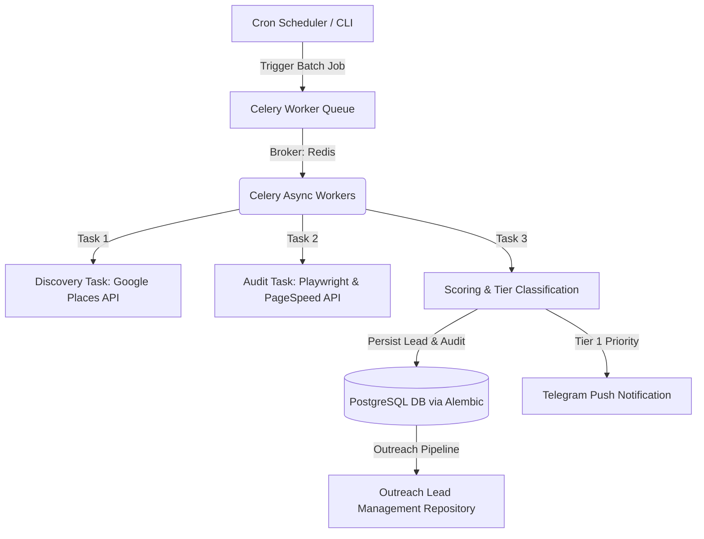

# Phase 2 Implementation Plan: Database Migrations, Task Architecture & Async Queue Engine

> **Project Name:** Opportunity Finder & Website Modernization Engine  
> **Phase:** 2 — Database Schema, Celery/Redis Async Workers & Outreach Pipeline  
> **Status:** Awaiting User Approval  

---

## 🎯 Phase 2 Objectives

Phase 2 transitions the system from synchronous pipeline execution to a **distributed, highly scalable, asynchronous background architecture**. This enables the Opportunity Finder engine to continuously process hundreds of business leads across multiple cities concurrently without blocking execution or hitting API rate limits.

---

## 🏗️ Technical Scope & Architectural Deliverables



### 1. Database Migration & Schema Architecture (Alembic + SQLAlchemy)
- Set up **Alembic** (`alembic.ini`, `alembic/env.py`, `alembic/versions/`).
- Define production database schema with 3 primary entities:
  1. `businesses` (Google Places data, rating, review count, website, location).
  2. `audits` (Mobile responsiveness, SSL, PageSpeed score, SEO tags, schema, modernization score).
  3. `outreach_leads` (Contact info, generated preview link, multi-touch outreach status: `NEW`, `LINKEDIN_SENT`, `EMAIL_SENT`, `WA_SENT`, `RESPONDED`, `CLOSED`).

### 2. Async Task Queue & Rate-Limiting Engine (Celery + Redis)
- Set up **Celery App** (`src/tasks/celery_app.py`, `config/celery_config.py`).
- Implement asynchronous Celery tasks:
  - `tasks.discovery.run_discovery_task(category, city, max_results)`
  - `tasks.crawler.run_site_audit_task(website_url)`
  - `tasks.pipeline.process_lead_batch_task(lead_ids)`
- Configure task rate-limiting (e.g., max 10 audits/min per domain to avoid IP blocking).
- Configure worker retries with exponential backoff for transient network errors.

### 3. Outreach Lead Tracking Module (`src/outreach`)
- Create `src/outreach/models.py` (Pydantic DTOs & SQLAlchemy Models).
- Create `src/outreach/repository.py` (CRUD functions for lead outreach state transitions and notes).

### 4. Technical Documentation (`/docs`)
- Author `docs/02_database_schema.md` (Detailed ERD & SQL schema breakdown).
- Author `docs/05_async_task_queue.md` (Celery/Redis worker topology & queue routing).

---

## 📂 Proposed Directory Structure Additions for Phase 2

```text
Opportunity Finder/
├── alembic/
│   ├── versions/
│   │   └── 001_initial_schema.py
│   ├── env.py
│   ├── script.py.mako
├── alembic.ini
├── config/
│   ├── settings.py
│   └── celery_config.py
├── docs/
│   ├── 02_database_schema.md
│   └── 05_async_task_queue.md
├── src/
│   ├── outreach/
│   │   ├── __init__.py
│   │   ├── models.py
│   │   └── repository.py
│   ├── tasks/
│   │   ├── __init__.py
│   │   ├── celery_app.py
│   │   ├── discovery_tasks.py
│   │   ├── crawler_tasks.py
│   │   └── pipeline_tasks.py
│   └── storage/
│       ├── db_session.py
│       ├── models.py
│       └── repository.py
├── tests/
│   ├── test_outreach.py
│   └── test_tasks.py
└── scripts/
    └── run_worker.sh
```

---

## 🛠️ Step-by-Step Implementation Strategy

### Step 1: Alembic Database Migration Setup
1. Initialize Alembic configuration for async PostgreSQL (`postgresql+asyncpg`).
2. Generate `001_initial_schema.py` migration script covering `businesses`, `audits`, and `outreach_leads`.
3. Test running `alembic upgrade head` against local Docker PostgreSQL container.

### Step 2: Celery & Redis Task Architecture
1. Configure `Celery` with `Redis` broker (`redis://localhost:6379/0`).
2. Implement async worker tasks for batch scraping and crawling.
3. Add rate limiting (`rate_limit='10/m'`) to Playwright crawling tasks.

### Step 3: Outreach Management Repository
1. Implement `OutreachRepository` to track outreach sequences, email attempts, and status updates.
2. Provide helper functions for updating lead statuses when outreach actions are taken.

### Step 4: Documentation & Unit Test Suite
1. Write `docs/02_database_schema.md` and `docs/05_async_task_queue.md`.
2. Write unit tests in `tests/test_tasks.py` and `tests/test_outreach.py`.
3. Verify test suite with `pytest`.

---

## ❓ Required User Confirmation

Please review this implementation plan for **Phase 2**. 
Once approved, I will begin Step 1 (Alembic Setup & Database Migrations).
