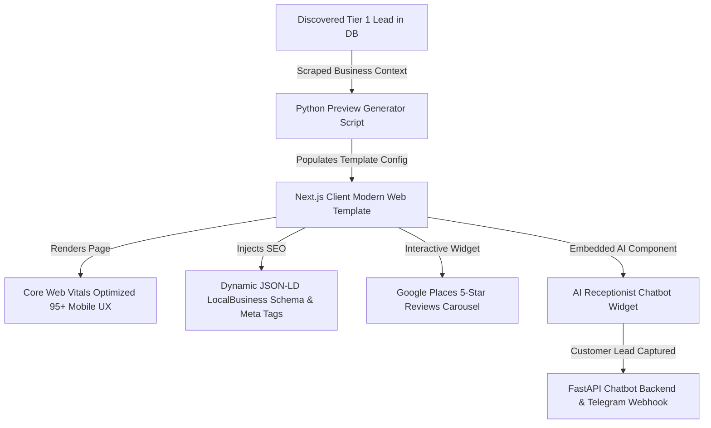

# Phase 3 Implementation Plan: Client Modernization Stack & Frontend Template Framework

> **Project Name:** Opportunity Finder & Website Modernization Engine  
> **Phase:** 3 — Client Web Templates, Automated Preview Generator, Dynamic SEO & AI Chatbot  
> **Status:** Awaiting User Approval  

---

## 🎯 Phase 3 Objectives

Phase 3 creates the **high-converting, modern client web application engine**. This stack replaces legacy, broken client websites with state-of-the-art Next.js web templates featuring instant mobile loading (95+ PageSpeed), baked-in Technical SEO schema, social proof widgets, and an **AI Receptionist Chatbot** that captures incoming leads in real time.

---

## 🏗️ Technical Scope & Architectural Deliverables



### 1. Next.js 14 Modern Web Template (`client-template`)
- **Aesthetics & Design Tokens**: Ultra-premium UI, sleek dark/light theme toggle, glassmorphism card surfaces, custom typography (Inter / Outfit / Plus Jakarta Sans via Google Fonts), subtle hover transitions and Framer Motion micro-animations.
- **Mobile-First Responsiveness**: 100% responsive across mobile, tablet, and desktop breakpoints with zero horizontal overflow.
- **Performance Optimization**: Next.js `Image` optimization, zero Cumulative Layout Shift (CLS), sub-second page loads achieving **95+ Google PageSpeed mobile score**.

### 2. Automated Preview Subdomain & Site Generator
- Build a Python generator utility (`scripts/generate_client_preview.py`) that reads lead records from PostgreSQL (`businesses` + `audits`).
- Generates a customized JSON/Config file mapping business parameters (`business_name`, `category`, `phone`, `city`, `google_rating`, `review_count`, `services`) into the Next.js template.
- Serves dynamic preview routes at `/preview/[business-slug]`.

### 3. Dynamic Technical SEO & Social Proof Engine
- **JSON-LD Microdata**: Auto-generates structured schema markup (`LocalBusiness`, `MedicalBusiness`, `LegalService`, `HVACBusiness`).
- **Dynamic Meta Tags**: Auto-renders `<title>`, `<meta name="description">`, `og:image`, and canonical tags.
- **Google Reviews Carousel**: Interactive React component rendering real 5-star review snippets and Google rating badge.

### 4. Embedded AI Receptionist & Chatbot Module
- **Frontend Widget**: Interactive chat widget floating on bottom-right of client site.
- **FastAPI Chatbot API Endpoint** (`src/api/chatbot.py`): Integrates OpenAI / Claude for answering business FAQs (hours, location, services).
- **Lead Capture Logic**: Collects customer `Name`, `Phone`, `Service Needed`, and `Preferred Date`.
- **Instant Lead Dispatch**: Sends real-time Telegram push notifications when a user submits their contact details through the client site chatbot.

---

## 📂 Proposed Directory Structure for Phase 3

```text
Opportunity Finder/
├── client-template/             # Next.js 14 Client App Template
│   ├── app/
│   │   ├── layout.tsx
│   │   ├── page.tsx
│   │   ├── preview/[slug]/page.tsx
│   │   └── api/chat/route.ts
│   ├── components/
│   │   ├── Header.tsx
│   │   ├── HeroSection.tsx
│   │   ├── ServicesSection.tsx
│   │   ├── ReviewCarousel.tsx
│   │   ├── BookingModal.tsx
│   │   └── ChatbotWidget.tsx
│   ├── public/
│   │   └── assets/
│   ├── package.json
│   └── tailwind.config.js / globals.css
├── src/
│   ├── api/
│   │   ├── __init__.py
│   │   ├── main.py              # FastAPI app
│   │   └── chatbot.py           # Chatbot lead capture API
│   └── generator/
│       ├── __init__.py
│       └── preview_builder.py   # Python preview generator logic
├── scripts/
│   └── generate_client_preview.py
└── docs/
    └── 03_frontend_template_architecture.md
```

---

## 🛠️ Step-by-Step Implementation Strategy

### Step 1: Initialize Next.js 14 Client Web Template
1. Create `client-template` workspace using Next.js 14 with TypeScript and Vanilla CSS / Tailwind CSS setup.
2. Build modern, high-converting UI components (Hero, Services, Google Reviews Carousel, Contact/Booking Modal).
3. Ensure dark/light glassmorphism styling and mobile performance.

### Step 2: Build Python Preview Generator Utility (`src/generator`)
1. Create `preview_builder.py` that queries PostgreSQL for target leads.
2. Formats scraped business info into Next.js dynamic routing JSON files.
3. Exposes preview rendering script `scripts/generate_client_preview.py`.

### Step 3: Implement Dynamic SEO & Microdata Generator
1. Add dynamic OpenGraph and JSON-LD `LocalBusiness` schema injection in Next.js `layout.tsx` / `page.tsx`.
2. Verify Google Rich Results test compliance.

### Step 4: Build AI Receptionist Chatbot & FastAPI Lead Backend
1. Create floating React chatbot component in `client-template/components/ChatbotWidget.tsx`.
2. Build FastAPI endpoint `src/api/chatbot.py` to process chat questions and capture lead submissions.
3. Connect chatbot lead capture to Telegram Alert Bot for instant notifications to business owners.

---

## ❓ Required User Confirmation

Please review this implementation plan for **Phase 3**.  
**Reply with your approval** to start Step 1 (Next.js Client Web Template Setup).
