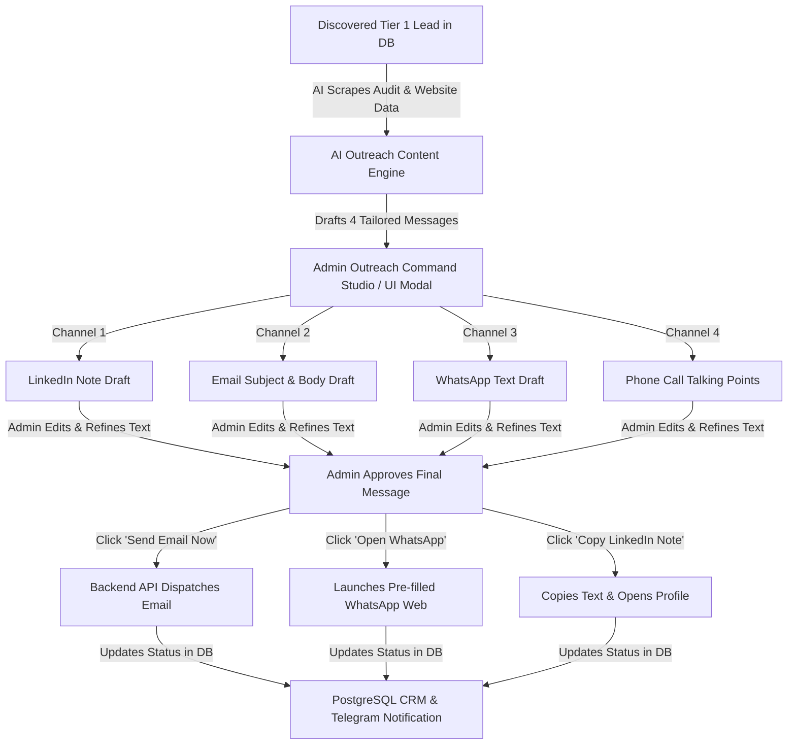

# Phase 4 Implementation Plan: Human-in-the-Loop Sales Studio, Admin Message Editor & Telegram Alerting Engine

> **Project Name:** Rebuildly & Website Modernization Engine  
> **Phase:** 4 — Admin-Controlled Outreach Command Center (LinkedIn ➔ Email ➔ WhatsApp ➔ Call), Content Editor & Anti-Spam Safety  
> **Status:** Pending User Approval  

---

## 🎯 Phase 4 Objectives

Phase 4 creates an **Admin-Controlled Sales Studio & Outreach Command Center**. Rather than fully automated auto-sending, the platform generates AI-drafted messages for **LinkedIn, Email, WhatsApp, and Phone Calls** tailored to each business lead. 

The Admin has **complete control**: you can review, edit, and refine the message content for any channel before clicking manual action buttons (`[📧 Send Email Now]`, `[💬 Open WhatsApp]`, `[🔗 Copy LinkedIn Note]`, `[📞 Launch Call Script]`).

---

## 🖥️ Human-in-the-Loop Admin Workflow



---

## 🎛️ Channel Sequence & Admin Action Controls

For every lead, the Admin UI presents an interactive **Outreach Studio Drawer** organized in your preferred 4-step order:

| Channel Step | Generated Content Draft | Admin Control Options | Action Trigger |
| :--- | :--- | :--- | :--- |
| **Step 1: LinkedIn** | Soft connection note referencing their local Google rating & mobile audit finding. | Editable Textarea for LinkedIn Note. | `[🔗 Copy LinkedIn Note & Open Profile]` |
| **Step 2: Cold Email** | Plain-text email with audit breakdown & bespoke Next.js preview link (`http://localhost:3009/sites/[slug]`). | Editable Subject Line + Editable Body Textarea. | `[📧 Send Email Now]` *(Fires email backend)* |
| **Step 3: WhatsApp** | Concise mobile follow-up text referencing the email and preview URL. | Editable WhatsApp Message Textarea. | `[💬 Send via WhatsApp Web]` *(Opens WhatsApp)* |
| **Step 4: Phone Call** | High-touch call talking points, objection handling, & mobile audit stats. | Read-Only / Editable Call Notes. | `[📞 Call Decision Maker]` *(Initiates phone call)* |

---

## 🛡️ Deliverability Fortress & Anti-Spam Safety

Because sending is controlled directly by you through the Admin Studio, you maintain 100% safety over your accounts:

1. **Zero-Spam Plain-Text Email Compiler (`src/outreach/email_compiler.py`)**:
   - Formats emails in clean, plain text matching genuine 1-on-1 human communication.
   - Spintax variation engine (`{Hi|Hello|Hey}`, `{noticed|saw|discovered}`) prevents pattern detection by Gmail & Outlook.
   - Real-time spam keyword scanner alerts Admin if draft contains spam words (*"free", "guaranteed", "buy now"*).
2. **Pre-Send Email Verification**:
   - Live NeverBounce/ZeroBounce verification badge shown in Admin UI (`Verified Safe ✅` or `Invalid Email ⚠️`) before you click send.
3. **Secondary Outreach Domains**:
   - Emails dispatch from dedicated secondary domains (`getvipinpal.com`, `vipinpal.co`) with strict **SPF**, **DKIM**, and **DMARC (`p=quarantine`/`p=reject`)**.
4. **Sending Rate Protection**:
   - Admin UI enforces a safety counter (e.g. Max 35 emails sent per day) with warning alerts to keep your domain 100% safe.

---

## 🏗️ Technical Scope & Architectural Deliverables

### 1. AI Outreach Draft Generator (`src/outreach/content_generator.py`)
- Automatically constructs tailored message drafts for LinkedIn, Email, WhatsApp, and Phone Calls using scraped business data, Google reviews, and technical audit scores.

### 2. Admin Outreach Studio Modal Component (`client-template/components/OutreachStudioModal.tsx`)
- Interactive React drawer / modal on the `/crm` dashboard allowing Admin to:
  - Tab through **LinkedIn ➔ Email ➔ WhatsApp ➔ Call Script**.
  - Edit subject line, body text, and message parameters in real-time.
  - Preview how the email will look on mobile & desktop before sending.
  - Click `[Send Email Now]`, `[Copy LinkedIn Note]`, or `[Open WhatsApp]`.

### 3. Manual Email Dispatcher API (`src/api/crm.py`)
- Endpoint `POST /api/v1/admin/crm/leads/{id}/send-email`:
  - Accepts Admin's final edited subject and body content.
  - Verifies recipient email, checks daily quota, sends via SMTP, and logs touchpoint timestamp in `OutreachLogModel`.

### 4. Real-Time Telegram Alert Bot (`src/notifications/telegram_bot.py`)
- Sends instant notifications to Vipin's smartphone when:
  1. 🔥 **New High-Value Lead Discovered** (Score ≥ 80).
  2. 👁️ **Prospect Clicks Preview URL** (Real-time intent notification).
  3. 📩 **Admin Manually Dispatches Email** (Activity log alert).

---

## 📂 Directory Structure for Phase 4 Deliverables

```text
Rebuildly/
├── src/
│   ├── api/
│   │   ├── admin.py
│   │   └── crm.py                  # CRM & Lead Outreach API routes
│   ├── outreach/
│   │   ├── __init__.py
│   │   ├── content_generator.py    # NEW: AI Draft Generator for LinkedIn/Email/WA/Call
│   │   ├── email_compiler.py       # Spam-proof Spintax email compiler
│   │   └── email_verifier.py       # Real-time email validation & safety checks
│   ├── notifications/
│   │   ├── __init__.py
│   │   └── telegram_bot.py         # Telegram Bot API with inline action buttons
│   └── storage/
│       ├── models.py               # OutreachLeadModel, OutreachLogModel, SuppressionModel
│       └── lead_repository.py      # CRM queries & status updates
├── client-template/
│   ├── app/
│   │   └── crm/
│   │       └── page.tsx            # Admin CRM Sales Pipeline Page
│   └── components/
│       └── OutreachStudioModal.tsx # NEW: Interactive Admin Message Draft & Editor Drawer
├── scripts/
│   └── test_telegram_alert.py      # Verification script for Telegram alerts
└── phase-4-implementation-plan.md  # THIS FILE
```

---

## 🧪 Verification & Testing Plan

1. **Message Draft Generator Test**: Verify AI generates customized, editable drafts for LinkedIn, Email, WhatsApp, and Call script for any lead.
2. **Admin Editor & Manual Trigger Test**: Open Outreach Studio drawer, edit email text, click `[Send Email Now]`, and verify edited email arrives in inbox.
3. **WhatsApp & LinkedIn Action Test**: Verify clicking `[Open WhatsApp]` opens pre-filled WhatsApp Web message and `[Copy LinkedIn]` copies text to clipboard.
4. **Telegram Push Alert Test**: Verify real-time push alert arrives on your phone when an email is sent or preview link is clicked.

---

## ❓ Confirmation & Next Steps

Please review this **Admin-Controlled Phase 4 Implementation Plan**.  
**Reply with your confirmation** to start implementing Step 1 (AI Draft Generator & Admin Outreach Studio Drawer).
