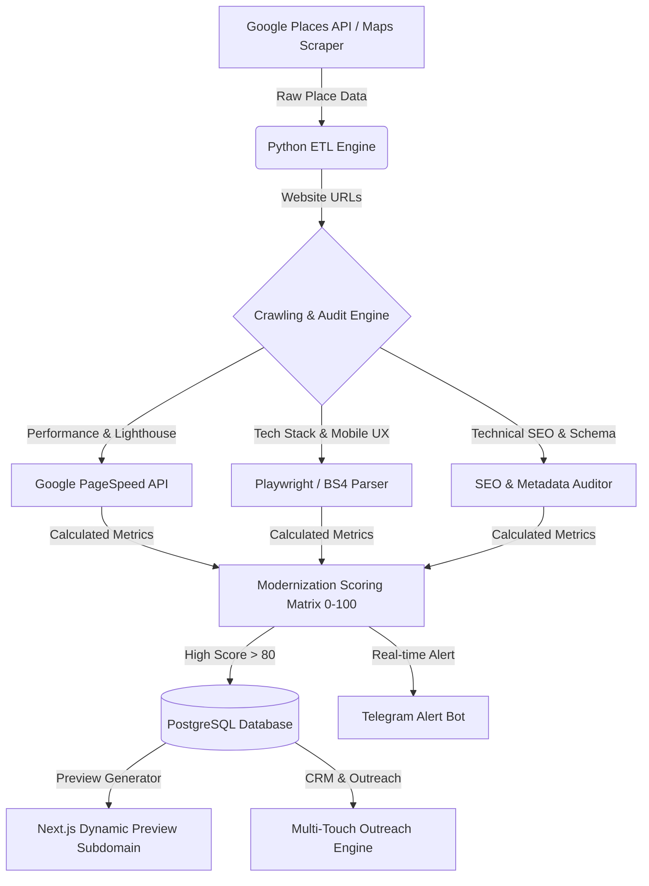

# Engineering & Product Roadmap: Rebuildly & Modernization System

> **Project Name:** Rebuildly & Website Modernization Engine  
> **System Architect:** Vipin Pal  
> **Target Release Model:** 5-Phase Incremental Deployment  
> **Tech Stack:** Python 3.11+ (FastAPI, Playwright, Celery), PostgreSQL, Redis, Node.js (Next.js, Tailwind/Vanilla CSS), Docker, AWS (EC2/S3).

---

## 🏗️ System Architecture Overview



---

## 🗺️ Phase 1: Core Backend & Scraping Engine (Weeks 1 – 2)

### 1.1 Business Discovery Module (Python)
- [ ] Implement `GooglePlacesClient` using official Google Places API (Text Search & Nearby Search).
- [ ] Fallback: Implement a Python scraping module (BeautifulSoup4 + Playwright) for initial directory discovery.
- [ ] Support query matrix filtering: `[Niche] + [Tier-2 City] + [Country]` (e.g., `Dentist + Manchester + UK`).
- [ ] Filter logic: `google_rating >= 4.2` and `user_ratings_total >= 50` (Targeting high-trust businesses).

### 1.2 Web Crawler & Technical Auditor Module
- [ ] **Mobile Responsiveness Checker:** Run Playwright in mobile emulation mode (iPhone 14 / Pixel 7 viewports) to check for horizontal scrollbars, overlapping elements, or tiny font sizes (<14px).
- [ ] **Google PageSpeed Insights API Integration:** Fetch Core Web Vitals (`FCP`, `LCP`, `CLS`, `TBT`) and overall performance score.
- [ ] **SEO & Metadata Parser:** Extract `<title>`, `<meta name="description">`, `<h1>` structure, canonical tags, and OpenGraph protocol.
- [ ] **Schema Markup Detector:** Parse `application/ld+json` for `LocalBusiness`, `MedicalBusiness`, `LegalService`, or `HVACBusiness` microdata.
- [ ] **Technology Detection:** Identify legacy tech stacks (WordPress < 5.0, PHP 5.x, table-based layouts, HTTP/1.1, missing SSL).
- [ ] **Conversion Audit:** Detect absence of click-to-call phone buttons, contact forms, interactive booking widgets, or live chatbots.

### 1.3 Modernization Scoring Algorithm
- [ ] Implement scoring logic (`0 – 100 points`) based on weighted technical penalties (e.g., No SSL = +15, PageSpeed < 50 = +10, No Schema = +10, No Mobile UX = +15).
- [ ] Classify leads:
  - 🔥 **Tier 1 (80-100):** High-priority target (Instant alert triggered).
  - 🟢 **Tier 2 (60-79):** Standard automated pipeline.
  - 🔴 **Tier 3 (<60):** Skip.

---

## 🗄️ Phase 2: Database Schema & Task Architecture (Week 3)

### 2.1 PostgreSQL Relational Database Schema
- [ ] Create database migration scripts (`Alembic` / `SQLAlchemy`).

```sql
CREATE TABLE businesses (
    id UUID PRIMARY KEY DEFAULT gen_random_uuid(),
    place_id VARCHAR(255) UNIQUE NOT NULL,
    name VARCHAR(255) NOT NULL,
    category VARCHAR(100) NOT NULL,
    city VARCHAR(100) NOT NULL,
    country VARCHAR(100) NOT NULL,
    address TEXT,
    phone VARCHAR(50),
    website VARCHAR(500),
    google_rating NUMERIC(2, 1),
    review_count INT,
    created_at TIMESTAMP WITH TIME ZONE DEFAULT CURRENT_TIMESTAMP
);

CREATE TABLE audits (
    id UUID PRIMARY KEY DEFAULT gen_random_uuid(),
    business_id UUID REFERENCES businesses(id) ON DELETE CASCADE,
    has_ssl BOOLEAN DEFAULT FALSE,
    is_mobile_friendly BOOLEAN DEFAULT FALSE,
    pagespeed_score INT,
    seo_score INT,
    has_schema BOOLEAN DEFAULT FALSE,
    has_booking_system BOOLEAN DEFAULT FALSE,
    has_ai_chatbot BOOLEAN DEFAULT FALSE,
    modernization_score INT NOT NULL,
    raw_audit_json JSONB,
    audited_at TIMESTAMP WITH TIME ZONE DEFAULT CURRENT_TIMESTAMP
);

CREATE TABLE outreach_leads (
    id UUID PRIMARY KEY DEFAULT gen_random_uuid(),
    business_id UUID REFERENCES businesses(id) ON DELETE CASCADE,
    contact_name VARCHAR(150),
    contact_email VARCHAR(255),
    linkedin_url VARCHAR(500),
    preview_subdomain_url VARCHAR(500),
    outreach_status VARCHAR(50) DEFAULT 'NEW', -- NEW, LINKEDIN_SENT, EMAIL_SENT, WA_SENT, RESPONDED, CLOSED
    last_contacted_at TIMESTAMP WITH TIME ZONE,
    notes TEXT
);
```

### 2.2 Redis & Celery Async Worker Queue
- [ ] Configure Redis as task broker for asynchronous crawling, PageSpeed API calls, and email dispatch.
- [ ] Rate-limit Celery workers to respect target site `robots.txt` and prevent IP blocks.

---

## 🌐 Phase 3: Client Modernization Stack & Frontend Framework (Weeks 4 – 5)

### 3.1 Next.js Modern Client Web Template Architecture
Design high-conversion, blazingly fast client websites to replace legacy client sites.

- [ ] **UI/UX Aesthetics:** Modern Dark/Light mode support, glassmorphism UI elements, subtle micro-animations (Framer Motion / CSS transitions), custom typography (Inter / Outfit / Plus Jakarta Sans via Google Fonts).
- [ ] **Mobile-First Design:** Fully responsive layout tested across mobile, tablet, and desktop breakpoints.
- [ ] **Core Web Vitals:** 95+ PageSpeed score on mobile with zero cumulative layout shift (CLS) and image optimization via Next.js `Image`.

### 3.2 Automated Preview Subdomain Generator
- [ ] Build a Python/Node script that takes scraped business data (`name`, `phone`, `city`, `google_reviews`) and populates a Next.js template.
- [ ] Auto-deploy previews to Vercel/AWS Cloudfront subdomains (`preview.yourdomain.com/business-slug`).

### 3.3 Technical SEO Foundation (Baked into Client Templates)
- [ ] **Schema Markup:** Auto-inject dynamic JSON-LD `LocalBusiness` / `MedicalBusiness` / `LegalService` schema tags.
- [ ] **Meta Tags:** Auto-generate Title tags (`[Business Name] | Top-Rated [Category] in [City]`) and Meta Descriptions.
- [ ] **Semantic HTML:** Strict `<h1>`, `<h2>`, `<article>`, `<section>`, `<footer>` structure.
- [ ] **Social Proof Widget:** Interactive Google Reviews carousel displaying 5-star feedback pulled from Places API.

### 3.4 AI Receptionist & Chatbot Module
- [ ] Build a lightweight AI chatbot component (React + Node API / Python FastAPI backend).
- [ ] Integrate OpenAI GPT-4o-mini / Claude 3.5 Haiku API for domain-specific Q&A (FAQs, operating hours, service prices).
- [ ] Implement Lead Capture logic: Collect customer `Name`, `Phone`, `Service Required`, and `Preferred Time Slot`.
- [ ] **Alert Integration:** Auto-send captured leads to the business owner via Telegram / WhatsApp webhook / Email.

---

## 📬 Phase 4: Sales, CRM & Outreach System (Weeks 6 – 7)

### 4.1 Outreach Infrastructure Setup
- [ ] Register 2 secondary outreach domains (e.g., `getvipinpal.com`, `vipinpal.co`).
- [ ] Configure DNS security records: **SPF**, **DKIM**, **DMARC**, and **MX** records.
- [ ] Connect domains to an automated warmup service (*Instantly.ai* / *Smartlead.ai*) for 21 days.

### 4.2 Multi-Touch Sequence Management
- [ ] **LinkedIn Module:** Automation tracking for connection requests & personalized messages.
- [ ] **Cold Email Engine (No Attachments):** HTML-free text template engine featuring embedded Loom GIF thumbnails and secure preview links.
- [ ] **WhatsApp / SMS Module:** Permission-based text inquiry dispatcher.

### 4.3 Real-Time Lead Alerting (Telegram Bot)
- [ ] Python Telegram Bot service that sends push notifications to Vipin's phone:
  ```text
  🔥 NEW HIGH-VALUE LEAD FOUND!
  Business: ABC Dental Manchester
  Google Rating: 4.8 ⭐ (320 reviews)
  Modernization Score: 88/100
  Issues: No Mobile UX, PageSpeed 32, No Booking Bot
  Preview Generated: https://preview.yourdomain.com/abc-dental
  ```

---

## 📈 Phase 5: Scaling, Optimization & SaaS Transition (Weeks 8+)

### 5.1 Analytics & Performance Tracking
- [ ] Track email open rates, click-through rates (CTR) on preview URLs, and reply rates via FastAPI analytics dashboard.
- [ ] A/B test email subject lines and Loom video thumbnails.

### 5.2 White-Label Agency Portal
- [ ] Create an admin dashboard for US/UK agency partners to view generated lead reports and order web modernizations under white-label terms.

### 5.3 SaaS Productization (Optional)
- [ ] Package the Python lead-scoring crawler into a B2B SaaS platform allowing external agencies to subscribe ($49 - $199/month) for city-specific target lists.

---

## 📋 Technology Matrix Summary

| Layer | Component | Chosen Technology |
| :--- | :--- | :--- |
| **Backend & Scraping** | Language / Framework | Python 3.11+, FastAPI, asyncio |
| **Crawling & Auditing** | Scraper Tools | Playwright, BeautifulSoup4, Google PageSpeed API |
| **Task Queue** | Broker & Worker | Redis + Celery |
| **Database** | RDBMS & Caching | PostgreSQL 15+ & Redis |
| **Client Frontend** | Web Framework | Next.js 14 (React), Tailwind CSS / Vanilla CSS |
| **AI Integration** | LLM Engine | OpenAI GPT-4o-mini / Anthropic API |
| **Infrastructure** | Hosting & Containerization | Docker, AWS EC2 / Lightsail, Vercel |
| **Notifications** | Alerting | Telegram Bot API |
